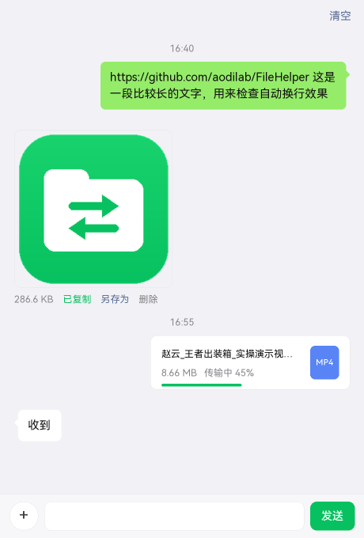
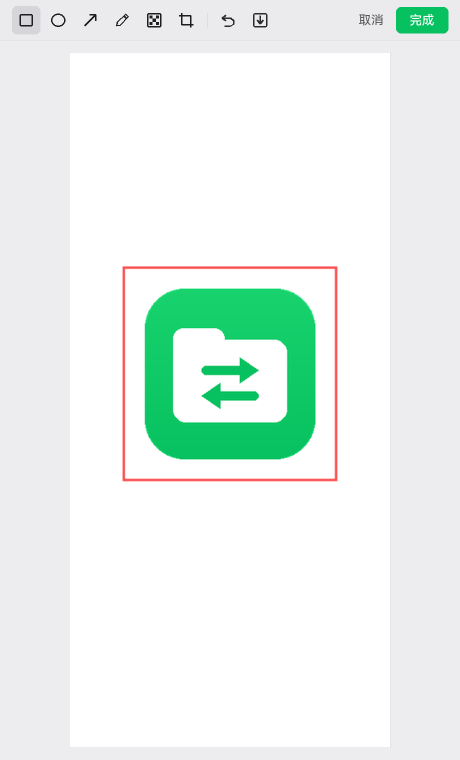

# 文件传输助手 (FileHelper)

<p align="left">
  <a href="https://github.com/aodilab/FileHelper/releases/latest"></a>
  <a href="LICENSE"></a>
  
</p>

同一 Wi-Fi 下的**局域网版「文件传输助手」**，用来在 Windows 电脑和手机之间双向互传**原图（含 iPhone `.HEIC`）、4K 大视频、任意文件与文字链接**。  
无需登录账号、不经过外网服务器、**100% 原画质不压缩**，几十 GB 的大视频也能秒开直传。

> ### ⬇️ 电脑端一键下载（Windows 10 / 11 64位，无需安装 Python）
> - **推荐安装版**：[**点击直接下载 `FileHelper-Setup.exe`**](https://github.com/aodilab/FileHelper/releases/latest/download/FileHelper-Setup.exe)（双击两步装好，自动创建桌面图标并放行局域网防火墙）
> - **免安装绿色版**：[**点击直接下载 `FileHelper-win64-portable.zip`**](https://github.com/aodilab/FileHelper/releases/latest/download/FileHelper-win64-portable.zip)（下载后**先解压**，再双击文件夹里的 `FileHelper.exe` 即用）
>
> *提示：页面右上角绿色的 `<> Code` 按钮是程序员看的源代码，普通用户直接点上面两行蓝字下载即可。*

---

## 一、 界面预览

| 空状态待命 | 双向聊天与截图粘贴 | 手机扫码连接 | 看图与框选标注 |
| :---: | :---: | :---: | :---: |
|  |  |  |  |

---

## 二、 三步上手教程

### 第 1 步：安装并打开电脑端
下载上方的 `FileHelper-Setup.exe` 安装打开（或解压绿色版双击 `FileHelper.exe`）。
- **遇到蓝色提示框「Windows 已保护你的电脑」**：点 **「更多信息」 → 「仍要运行」**（个人免费开源软件未购买商业签名证书，Windows 首次打开都会提示）。
- **遇到「Windows 防火墙警报」**：勾选网络并点 **「允许访问」**（如果点取消，手机将无法连上电脑）。

### 第 2 步：手机扫码连接
1. 确保**电脑与手机连在同一个路由器下**（电脑插网线、手机连该路由器的 Wi-Fi 也可以）。
2. 点击电脑窗口右上角的 **「手机连接」**，弹出二维码。
3. 用 **iPhone 原生相机**（或安卓系统浏览器）扫码打开网页即可互传。
   - **切勿使用「微信扫一扫」**：微信内置网页会限制存相册和下载大文件，若不小心用微信扫开，点右上角 `···` 选「在默认浏览器打开」即可。
   - **固定到手机桌面（推荐）**：在 iPhone Safari 底部点「分享按钮 → **添加到主屏幕**」，以后像普通 App 一样从桌面直接点开，无需重复扫码。

### 第 3 步：日常双向收发
- **电脑发给手机**：
  - **发文件 / 大视频**：把文件或文件夹直接拖进窗口（或直接拖到桌面「文件传输助手」图标上），不占双倍硬盘空间；
  - **发截图**：截图后按 `Ctrl + V` 预览，按回车直接发出；点击图片可打开独立看图器进行**方框、圆框、箭头、画笔、马赛克、裁剪**标注；
  - **发文字 / 链接**：在底部输入框粘贴回车即发，手机端轻点气泡即可复制。
- **手机发给电脑**：
  - 点击手机页面右下角 **`+`** 选择照片、视频或文件，选好点右上角 `✓` **一步直发原片**（无二次确认页，iPhone `.HEIC` 原图与 4K 视频均原样直传）；
  - **长按手机上的任意消息或图片**，可弹出菜单执行 **保存到相册 / 复制 / 编辑标注 / 下载 / 删除**。
- **彻底清空不留痕**：点击右上角 **「清空」**，电脑与手机列表以及电脑本地缓存文件会同步 **100% 物理删除**。

---

## 三、 为什么比传统传文件更省心？

| 方式 | 常见痛点 | 文件传输助手 (FileHelper) |
| :--- | :--- | :--- |
| **微信文件传输助手** | 照片视频会被压缩变糊、文件大小受限、需登录账号走外网 | **100% 原图原片无损**、几十 GB 视频不限大小、无需登录 |
| **网盘 / 隔空投送** | 网盘受限于宽带上传慢且占空间；Windows 与 iPhone 无法隔空投送 | **纯局域网直连**，不耗外网流量，直接跑满家里路由器 Wi-Fi 速度 |
| **数据线拷贝** | 每次都要找线插拔，导入导出照片目录繁琐，不能传文字链接 | **无线扫码即连**，文字链接、剪贴板截图、照片视频都在同一个聊天流里搞定 |

---

## 四、 进阶技巧：iPhone「快捷指令」一键存电脑原片（可选）

如果经常把电脑剪好的大视频或大批原图存进 iPhone 相册，可配置一个桌面按钮一键入库：
1. 打开 iPhone **「快捷指令」** App，点右上角 `+` 新建指令，依次添加 2 个动作：
   - **获取 URL 的内容**：地址填电脑二维码下方显示的网址加 `/api/latest`（例如 `http://192.168.1.5:8899/api/latest`）；
   - **存储到相簿**：将「URL 的内容」存储到「最近项目」。
2. 点底部分享按钮选择 **「添加到主屏幕」**，以后电脑拖入照片视频后，点一下手机桌面图标即可直接存进系统相册。

---

## 五、 常见问题排查

1. **手机扫码后一直转圈打不开网页？**
   - **检查是否同一网络**：电脑和手机必须连在同一个路由器下（校园网/酒店 Wi-Fi 若开启了「AP 隔离」禁止设备互访，可改开手机个人热点让电脑连）。
   - **检查代理软件**：若电脑或手机开了代理软件的 **TUN 虚拟网卡 / 全局模式**，可能会拦截局域网直连，关闭 TUN 模式或切换为规则模式再试。
   - **检查 Windows 防火墙**：若使用绿色免安装版且首次未点「允许访问」，可在 Windows 设置中将当前 Wi-Fi 设为 **「专用网络」**，或改装 `FileHelper-Setup.exe` 自动配置放行规则。
2. **绿色免安装版怎么卸载？标准安装版怎么卸载？**
   - **绿色版**：直接关闭软件窗口后，把解压出来的文件夹删掉即可，无任何注册表残留。
   - **安装版**：在 Windows「设置 → 应用 → 已安装的应用」中找到 **文件传输助手 (FileHelper)** 点击卸载，会自动清理程序、防火墙规则与本地缓存。

---

## 六、 开发者说明（源码运行与构建）

环境要求：Windows 10 / 11，Python 3.10+。

```powershell
git clone https://github.com/aodilab/FileHelper.git
cd FileHelper
pip install -r requirements.txt
python build.py              # 启动桌面端
python build.py --shortcut   # 在桌面生成快捷方式
python build.py --package    # 打包绿色版 .zip（安装了 Inno Setup 6 则同步构建 Setup.exe）
python build.py --audit      # 渲染五态视觉快照并校验代码规范
```
